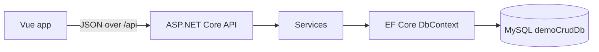

# Demo CRUD

Demo CRUD is a learning application for building a permission-based CRUD API with ASP.NET Core, Entity Framework Core, and MySQL, plus a Vue frontend. The API manages users, roles, and a rights catalog. A JWT access token identifies the caller. Each protected request is allowed or denied from the caller's role rights as they are in the database at that moment, so a right that is added or removed applies immediately, including to users who are already signed in.

The repository name is `demoCrudBackend`. The running application is titled **Demo CRUD**.

## Project Overview

A signed-in caller can maintain their own profile, list and maintain users and roles, and assign or remove rights on a role, within the rights that caller's role holds in the database. A read-only rights catalog shows only the rights the caller currently holds. One seeded system user and one system role are protected from ordinary edits. The Vue app provides the screens for that work and a light, dark, or system theme.

This repository is meant for a developer learning the stack, and for anyone who needs to clone it and run it locally. It is not a multi-tenant product, and it has no production deployment configuration in the repo.



The browser stores one access token for the tab and hides routes and buttons the signed-in user cannot use. The API validates the token and re-reads the caller's role and rights from the database on every protected request. Authentication, the permission model, and the theme are described in [docs/PROJECT_CONTEXT.md](docs/PROJECT_CONTEXT.md).

| Area | Role in the project |
| --- | --- |
| Backend | ASP.NET Core Web API. Login, account, users, roles, role rights, and the rights catalog are implemented. |
| Frontend | Vue application. Login, dashboard, users, roles, rights, account, and theme call this API. |
| Docs | Architecture, setup notes, and learning status. See [Further reading](#further-reading). |

Frontend setup is documented in [frontend/README.md](frontend/README.md).

## Project Status

### Backend: completed

Phases recorded in [docs/LEARNING_PROGRESS.md](docs/LEARNING_PROGRESS.md) through role, role-right, and rights APIs are implemented in source:

- Username and password login that returns a JWT access token and an expiry time.
- Account profile read and update, and a password change, for the user on the token.
- Permission policies for users, roles, role-right changes, and the rights catalog.
- User create, read, update, delete, and paged list.
- Role create, read, update, delete, and paged list. The system role is hidden on read and rejected on write.
- Assign and remove rights on a role. The batch is all-or-nothing, and the caller can change only rights they currently hold.
- Paged, read-only rights catalog filtered to the caller's current rights.
- Database-authoritative permissions: after the JWT is validated, each request loads the caller's current role and rights, so grants and revocations apply on the next request. `GET /api/auth/me` returns them, and authenticated responses carry an `X-Access-Version` fingerprint.
- Seed data for roles, rights, role-right links, and one system user. Migrations live under `backend/demoCrudBackend/Migrations`.
- One JSON envelope for success and failure, including validation and authentication failures.
- OpenAPI and Scalar UI in the Development environment.
- xUnit integration tests in `backend/DemoCrudBackend.Tests`. They host the API with SQLite in memory and do not open MySQL.

Unhandled exceptions return the JSON envelope with HTTP 500 and a generic message. Login and password change are rate limited in memory. There is no refresh-token endpoint. New rights are added in code and by a seed migration, not by an HTTP write API.

### Frontend: learning UI complete

The Vue app signs in against the API, keeps the access token for the browser tab, and hides routes and buttons from the signed-in user's current rights. It re-reads those rights from `GET /api/auth/me` when they change (see [How rights changes reach signed-in users](#how-rights-changes-reach-signed-in-users)). The API still allows or denies every request.

- Login and logout. Invalid credentials stay on the sign-in form. A successful login clears the password field. The login page uses the same theme control as the rest of the app.
- The access token is stored in `sessionStorage`. Axios sends `Authorization: Bearer` and clears the session on HTTP 401. Token expiry and a 401 on a protected page return you to sign-in and remember the path. Log out does not.
- Router guards for authentication and permissions. A missing permission opens an access-denied page. An unknown path renders a public 404 page with a link back to the dashboard. That page does not require a token and does not sit inside the signed-in layout.
- Theme preference `light`, `dark`, or `system`, stored in `localStorage` under `app-theme`. The header control offers System, Light, and Dark. System follows the operating system. Light and Dark are saved choices.
- Layout with a collapsible sidebar and a mobile drawer: Dashboard, Users, Roles, Rights Management, and Account.
- Dashboard: a welcome line and shortcut cards. There is no statistics or activity API.
- Users: paged list, create, edit, delete, and a role dropdown. Edit and delete are hidden for the signed-in account and for system accounts. Opening those edit URLs directly explains why the form is unavailable.
- Roles: paged list, create, edit, and delete. The system role is absent because the API does not return it.
- Rights: one page at `/rights` for search, multi-select, assign, and remove. `/roles/:id/rights` redirects there with `roleId`.
- Account: profile loaded from `GET /api/account`, an edit form for the fields that API accepts, and a separate password form. Account, user, and role forms ask before leaving unsaved changes, including on refresh or tab close.
- Date of birth is a calendar date. The form and the API both treat "today" as the current UTC date and reject a later date.
- The forms offer Gender as a select (Male, Female, Other, or empty). The API itself accepts any gender text up to 50 characters. Phone number is free text up to 50 characters in both.
- Requests time out after 30 seconds. A timed-out save tells the user to refresh and check whether the change was saved before retrying. Network failures and server errors show a message and keep the typed values. Submit buttons are disabled while a save runs, so a double click sends one request.
- Keyboard and layout: visible focus outlines on every control, a mobile drawer that reports its state with `aria-expanded` and returns focus on Escape, and tables that scroll inside their own container. Long names and emails wrap inside a capped column so the Actions column stays reachable.
- Vitest, ESLint, and Prettier.

`docs/PROJECT_HANDOVER_PROMPT.md` is the mentor brief for the current app. Use this README and [frontend/README.md](frontend/README.md) to run it.

## Technology Stack

Versions below are the ones declared in the project files.

### Backend

| Technology | Where it is declared |
| --- | --- |
| C# / ASP.NET Core Web API | `TargetFramework` `net10.0` in `backend/demoCrudBackend/DemoCrudBackend.csproj` |
| Entity Framework Core 9.0.9 | same `.csproj` |
| Pomelo.EntityFrameworkCore.MySql 9.0.0 | same `.csproj` |
| MySQL database `demoCrudDb` | connection string name `DefaultConnection`; charset `utf8mb4` in the initial migration |
| JWT Bearer authentication 10.0.15 | same `.csproj`; configured in `Program.cs` |
| ASP.NET Core `PasswordHasher<User>` | registered in `Program.cs` (password hashing only; there is no Identity UI or Identity user store) |
| OpenAPI 10.0.8 | `Microsoft.AspNetCore.OpenApi` |
| Scalar API reference 2.16.2 | `Scalar.AspNetCore`, mapped in Development |

Architecture is **Controller → Service → DbContext**. There is no repository layer.

The test project targets `net10.0` and uses xUnit 2.9.3, Microsoft.NET.Test.Sdk 17.14.1, `Microsoft.AspNetCore.Mvc.Testing` 10.0.15, and `Microsoft.EntityFrameworkCore.Sqlite` 9.0.9. SQLite is the test host only.

### Frontend

| Technology | Where it is declared |
| --- | --- |
| Vue 3 | `frontend/package.json` (`vue`) |
| TypeScript (strict) | `frontend/tsconfig.app.json` |
| Vite 8 | `frontend/package.json` and `frontend/vite.config.ts` |
| Vue Router | `frontend/src/router/index.ts` |
| Pinia | Auth store in `frontend/src/stores/authStore.ts` |
| Axios | `frontend/src/services/http.ts` |
| Tailwind CSS 4 | `@tailwindcss/vite` in `frontend/vite.config.ts` |

The package manager is npm. `frontend/package-lock.json` is the lockfile. There is no `pnpm-lock.yaml` or `yarn.lock`.

## Repository Structure

```text
demoCrudBackend/
├── .cursor/rules/                 # Backend and frontend conventions for this repo
├── backend/
│   ├── demoCrudBackend.slnx       # API project and the test project
│   ├── DemoCrudBackend.Tests/     # xUnit tests. SQLite in memory, not MySQL
│   └── demoCrudBackend/           # ASP.NET Core Web API
│       ├── Authorization/         # Permission names, policies, caller helpers
│       ├── Common/                # API envelope, validation, OpenAPI helpers
│       ├── Controllers/           # Auth, Account, Users, Roles, Rights
│       ├── Data/                  # ApplicationDbContext and MySQL error helpers
│       ├── Dtos/                  # Request and response models
│       ├── Migrations/            # EF Core migrations, including seed data
│       ├── Models/                # User, Role, Right, RoleRight
│       ├── Services/              # Auth, token, account, user, role, and right services
│       ├── Program.cs
│       ├── appsettings.json
│       └── appsettings.Development.json
├── docs/                          # Design notes and learning status (not a substitute for the code)
├── frontend/                      # Vue app (see frontend/README.md)
└── README.md
```

| Path | Purpose |
| --- | --- |
| `docs/PROJECT_CONTEXT.md` | Backend modules, API table, and architectural decisions |
| `docs/LEARNING_PROGRESS.md` | Completed milestones and what is still open |
| `docs/PROJECT_HANDOVER_PROMPT.md` | Mentor brief for the current app |
| `.cursor/rules/` | Conventions for API shape, auth, EF Core services, and the Vue app |

## Prerequisites

Install these before the steps below.

| Requirement | Verified from |
| --- | --- |
| .NET 10 SDK | `net10.0` in `DemoCrudBackend.csproj`. No `global.json` pins a patch version. |
| `dotnet-ef` global tool **9.0.9** | Matches `Microsoft.EntityFrameworkCore.Tools` 9.0.9. The repo has no `.config/dotnet-tools.json`. |
| MySQL server | Pomelo provider. The app calls `ServerVersion.AutoDetect`. Database name used by this repo: `demoCrudDb`. |
| Node.js `^20.19.0` or `>=22.12.0` | `engines` field of the installed Vite 8 package. |
| npm | Comes with Node.js. The frontend lockfile is `package-lock.json`. |
| Git | Clone URL: `https://github.com/wajidafridi/demoCrudBackend.git` |

A MySQL client (MySQL Workbench, the `mysql` CLI, or similar) is useful for creating the database. The .NET SDK does not include MySQL.

Check the SDK and Node versions:

```bash
dotnet --version
node --version
npm --version
```

## Getting Started

Run these from a terminal at the repository root after you clone.

### 1. Clone the repository

```bash
git clone https://github.com/wajidafridi/demoCrudBackend.git
```

### 2. Open the repository root

```bash
cd demoCrudBackend
```

### 3. Configure the backend

The API will not start until `Jwt:Key`, `Jwt:Issuer`, and `Jwt:Audience` are all set. Issuer and audience are already in `backend/demoCrudBackend/appsettings.json`. The signing key is not. Store the key with [user secrets](https://learn.microsoft.com/aspnet/core/security/app-secrets) so it stays out of git.

The project user-secrets id is in `DemoCrudBackend.csproj`. From the repository root:

```bash
dotnet user-secrets set "Jwt:Key" "local-development-signing-key-change-me" --project backend/demoCrudBackend/DemoCrudBackend.csproj
```

Use your own random value. It must be at least 32 bytes (32 ASCII characters is enough). Startup throws if the key is missing or shorter than that.

`appsettings.json` keeps the key `ConnectionStrings:DefaultConnection`, and its committed value is a placeholder. Put the real MySQL account in user secrets. In Development, user secrets override `appsettings.json`. Do not write a real password into the committed file.

```bash
dotnet user-secrets set "ConnectionStrings:DefaultConnection" "server=localhost;database=demoCrudDb;user=YOUR_MYSQL_USER;password=YOUR_MYSQL_PASSWORD;" --project backend/demoCrudBackend/DemoCrudBackend.csproj
```

The same key can be supplied for any environment with an environment variable. This does not change user secrets already stored on your machine.

PowerShell:

```powershell
$env:ConnectionStrings__DefaultConnection = "server=localhost;database=demoCrudDb;user=YOUR_MYSQL_USER;password=YOUR_MYSQL_PASSWORD;"
```

Bash:

```bash
export ConnectionStrings__DefaultConnection="server=localhost;database=demoCrudDb;user=YOUR_MYSQL_USER;password=YOUR_MYSQL_PASSWORD;"
```

Details and a full example are in [Backend configuration](#backend-configuration).

### 4. Create the database

Create an empty database named `demoCrudDb` if it does not exist. The initial migration sets the charset to `utf8mb4`.

```sql
CREATE DATABASE IF NOT EXISTS demoCrudDb
  CHARACTER SET utf8mb4
  COLLATE utf8mb4_unicode_ci;
```

The MySQL account in the connection string needs permission to use this database. If that account is allowed to create databases, `dotnet ef database update` in the next step can create `demoCrudDb` for you and this statement is optional.

### 5. Install EF Core tools and apply migrations

Install the tool once per machine. The version matches the EF Core package in the `.csproj`.

```bash
dotnet tool install --global dotnet-ef --version 9.0.9
```

If an older `dotnet-ef` is already installed:

```bash
dotnet tool update --global dotnet-ef --version 9.0.9
```

Apply every migration, including the seed migration:

```bash
dotnet ef database update --project backend/demoCrudBackend/DemoCrudBackend.csproj
```

That command creates the tables and seeds roles, rights, role-right rows, and the system user. Migration files are in `backend/demoCrudBackend/Migrations`.

### 6. Run the backend

`frontend/.env.example` points at the HTTPS profile. Start the API with that profile and leave the terminal running:

```bash
dotnet run --project backend/demoCrudBackend/DemoCrudBackend.csproj --launch-profile https
```

The API is at `https://localhost:7193`. The same profile also listens on `http://localhost:5118` and redirects that port to HTTPS. A frontend base URL of `http://localhost:5118/api` will fail while this profile is running.

To use plain HTTP instead, start `--launch-profile http` (API at `http://localhost:5118`) and set `VITE_API_BASE_URL` to `http://localhost:5118/api`.

### 7. Configure the frontend

`frontend/.env` is gitignored. Copy the example file. Its API base URL is `https://localhost:7193/api`.

PowerShell:

```powershell
Copy-Item frontend/.env.example frontend/.env
```

Bash:

```bash
cp frontend/.env.example frontend/.env
```

Optional development-only keys `VITE_DEV_LOGIN_USERNAME` and `VITE_DEV_LOGIN_PASSWORD` can prefill the sign-in form when you run `npm run dev`. They are commented out in `.env.example`. Do not commit real credentials. Production builds and tests do not prefill the form.

### 8. Install frontend dependencies

```bash
npm install --prefix frontend
```

### 9. Run the frontend

In a second terminal, from the repository root:

```bash
npm run dev --prefix frontend
```

Vite is not given a custom port in `frontend/vite.config.ts`, so the dev server uses Vite's default: `http://localhost:5173`. That origin is the value of `Cors:AllowedOrigin` in `appsettings.Development.json`.

### 10. How the frontend talks to the backend

The shared Axios client in `frontend/src/services/http.ts` uses `VITE_API_BASE_URL`. With the example env file, requests go to `https://localhost:7193/api/...`.

Sign in at `http://localhost:5173/login`. The seeded username is `superadmin`. The password is the development seed recorded on that user in `backend/demoCrudBackend/Data/ApplicationDbContext.cs`. Use it only on your machine.

CORS is prepared for the browser: in Development, the API allows origin `http://localhost:5173` with headers `Authorization` and `Content-Type`, and methods `GET`, `POST`, `PUT`, `DELETE`, and `OPTIONS`.

Protected routes expect:

```http
Authorization: Bearer <access_token>
```

Scalar remains available for calling the API without the Vue app. See [API documentation](#api-documentation).

## Backend Configuration

Configuration is the standard ASP.NET Core stack: `appsettings.json`, then `appsettings.{Environment}.json`, then user secrets in Development, then environment variables. Later sources override earlier ones.

| File | Committed? | What it holds in this repo |
| --- | --- | --- |
| `backend/demoCrudBackend/appsettings.json` | Yes | Placeholder `ConnectionStrings:DefaultConnection` (no real database password), `Jwt:Issuer`, `Jwt:Audience`, `Jwt:AccessTokenMinutes` (30). No signing key. |
| `backend/demoCrudBackend/appsettings.Development.json` | Yes | `Cors:AllowedOrigin` = `http://localhost:5173`, plus logging. |
| `backend/demoCrudBackend/Properties/launchSettings.json` | Yes | Launch profiles. Both set `ASPNETCORE_ENVIRONMENT` to `Development`. |
| User secrets | No (stored outside the repo) | Put `Jwt:Key` and the local `ConnectionStrings:DefaultConnection` here. |

### Keys the process reads

| Key | Required | Notes |
| --- | --- | --- |
| `ConnectionStrings:DefaultConnection` | Yes, to open MySQL | Pomelo connection string. `ServerVersion.AutoDetect` reads it at startup, so MySQL must be reachable when the process starts. |
| `Jwt:Key` | Yes | Absent from committed JSON. Minimum 32 bytes. HS256. |
| `Jwt:Issuer` | Yes | Committed value: `DemoCrudBackend`. |
| `Jwt:Audience` | Yes | Committed value: `DemoCrudFrontend`. |
| `Jwt:AccessTokenMinutes` | Yes, to issue a token | Integer from 1 through 1440. Committed value: `30`. |
| `RateLimiting:LoginPermitLimit` | No | Login attempts allowed per IP in each window. Default `5`. |
| `RateLimiting:LoginWindowSeconds` | No | Login window length. Default `60`. |
| `RateLimiting:ChangePasswordPermitLimit` | No | Password-change attempts allowed per user in each window. Default `5`. |
| `RateLimiting:ChangePasswordWindowSeconds` | No | Password-change window length. Default `60`. |
| `Cors:AllowedOrigin` | Only if a browser on another origin calls the API | Single origin. If this value is empty, CORS is not registered. |

Environment-variable form uses a double underscore, for example `Jwt__Key` and `ConnectionStrings__DefaultConnection`.

### Safe local example

Do not commit real passwords or signing keys. User secrets for this project look like this (placeholders only):

```json
{
  "ConnectionStrings:DefaultConnection": "server=localhost;database=demoCrudDb;user=YOUR_MYSQL_USER;password=YOUR_MYSQL_PASSWORD;",
  "Jwt:Key": "local-development-signing-key-change-me"
}
```

Set them with `dotnet user-secrets set`, as in [Getting started](#3-configure-the-backend). List the stored keys on your machine:

```bash
dotnet user-secrets list --project backend/demoCrudBackend/DemoCrudBackend.csproj
```

The committed connection string is only a placeholder for `demoCrudDb`. Set the local account with the user-secrets command in [Getting started](#3-configure-the-backend), or with `ConnectionStrings__DefaultConnection`. Keep real database passwords out of git.

## Database Setup

| Item | Value |
| --- | --- |
| Engine | MySQL, via Pomelo.EntityFrameworkCore.MySql 9.0.0 |
| Database name | `demoCrudDb` |
| DbContext | `DemoCrudBackend.Data.ApplicationDbContext` |
| Tables | `Users`, `Roles`, `Rights`, `RoleRights` |
| Charset | `utf8mb4` (set in `Migrations/20260623111503_Initial.cs`) |

Connection string shape:

```text
server=localhost;database=demoCrudDb;user=YOUR_MYSQL_USER;password=YOUR_MYSQL_PASSWORD;
```

`Users.RoleId` references `Roles` with delete behavior **Restrict**. Deleting a role that still has users returns 409. `RoleRights` rows are removed when their role or right is removed (cascade).

### Migrations in the repo

Apply them with the command in [Getting started](#5-install-ef-core-tools-and-apply-migrations). Do not hand-edit the snapshot. From the repository root, useful commands are:

```bash
dotnet ef migrations list --project backend/demoCrudBackend/DemoCrudBackend.csproj
dotnet ef database update --project backend/demoCrudBackend/DemoCrudBackend.csproj
```

Migrations currently in `backend/demoCrudBackend/Migrations`:

| Migration | What it contributes |
| --- | --- |
| `20260623111503_Initial` | Tables and `utf8mb4` |
| `20260623124220_SeedData` | Early seed |
| `20261111182209_AddSystemProtectionAndRoleNameConstraints` | System flags and role name rules |
| `20261112084115_AddUserUniquenessAndNameLengths` | User name and email uniqueness and lengths |
| `20261112110243_SeedRoleManagementRights` | Role-management rights and the current role-right seed |

After `database update`, the database contains:

| Seed | Detail |
| --- | --- |
| Roles | `SuperAdmin` (`IsSystem`), `Admin`, `User` |
| Rights | `User_View`, `User_Create`, `User_Edit`, `User_Delete`, `Role_View`, `Role_Create`, `Role_Edit`, `Role_Delete`, `RoleRight_Assign`, `Right_View` |
| SuperAdmin role | Every right |
| Admin role | Every right. This is an ordinary role, not a system role. |
| User role | `User_View` only |
| System user | Username `superadmin`, system role. The local password is the development seed in `backend/demoCrudBackend/Data/ApplicationDbContext.cs`. Use it only on your machine. It is not copied into these docs. |

Add a new migration only when the model changes. From the repository root, with a descriptive name:

```bash
dotnet ef migrations add YourMigrationName --project backend/demoCrudBackend/DemoCrudBackend.csproj
```

## Running the Application

Use two terminals. Start the API first.

**Terminal 1 — API** (repository root):

```bash
dotnet run --project backend/demoCrudBackend/DemoCrudBackend.csproj --launch-profile http
```

**Terminal 2 — Vue** (repository root):

```bash
npm run dev --prefix frontend
```

You can also `cd frontend` and run `npm run dev`.

| Surface | URL with the `http` profile | When it is available |
| --- | --- | --- |
| HTTPS API | `https://localhost:7193` | `https` profile. This matches `frontend/.env.example`. Routes are under `/api`. |
| HTTP API | `http://localhost:5118` | `http` profile only. The `https` profile redirects this port. |
| OpenAPI document | `https://localhost:7193/openapi/v1.json` | Development only (`MapOpenApi`). Use port 5118 if you started the `http` profile. |
| Scalar API reference | `https://localhost:7193/scalar/v1` | Development only. `/scalar` redirects to `/scalar/`. |
| Vue dev server | `http://localhost:5173` | Vite default. This repo does not set `server.port`. Sign in at `/login`. |

The `https` launch profile listens on `https://localhost:7193` and `http://localhost:5118`, and it redirects HTTP to HTTPS. `frontend/.env.example` uses `https://localhost:7193/api`. Use the `http` profile only when `VITE_API_BASE_URL` is `http://localhost:5118/api`.

Build and restore without running:

```bash
dotnet restore backend/demoCrudBackend.slnx
dotnet build backend/demoCrudBackend.slnx
dotnet test backend/demoCrudBackend.slnx
```

`dotnet test` runs `backend/DemoCrudBackend.Tests`. That host sets `Database:Provider` to `Sqlite` and uses an in-memory database. Leave `Database:Provider` unset for local development so the API uses MySQL.

Frontend checks, from `frontend/`:

```bash
npm test
npm run lint
npm run format:check
npm run build
```

`npm run build` runs `vue-tsc -b` and then `vite build`.

### Accounts for manual role testing

Manual RBAC checks use three local accounts. Create them in your own local database and keep their passwords out of the repository.

1. **SuperAdmin**: the seeded system user. Its role has every right and cannot be edited through the API. Never delete it or remove its rights.
2. **Admin**: sign in as SuperAdmin, open **Roles**, and use the `Admin` role (seeded) or create one. In **Rights Management**, give it the rights you want to test. Then create a user in that role from **Users → Create user**.
3. **Restricted user**: create a role with no rights (or only some), then a user in that role.

Each browser tab keeps its own session (`sessionStorage`), so you can keep all three signed in at once in separate tabs. Use disposable users and roles for delete tests. To check live revocation, keep the Admin tab open, remove a right in the SuperAdmin tab, then act in the Admin tab: the API answers 403 at once, and the Admin tab's buttons and routes update as described in [How rights changes reach signed-in users](#how-rights-changes-reach-signed-in-users).

## Authentication

Login is the only anonymous API. Every other controller requires a valid access token plus a permission policy.

1. The client sends `POST /api/auth/login` with JSON `username` and `password` (both required, each at most 100 characters).
2. `AuthService` trims the username, loads the user, and checks the password with `PasswordHasher<User>`. A failed match returns 401 with message `Invalid username or password.`
3. On success the API copies the user's role name and that role's right names into a JWT. The response `data` also includes `id`, `userName`, `email`, `roleId`, `roleName`, `accessToken`, `expiresAtUtc`, `permissions`, and `accessVersion`. Email and role id are response fields. They are not JWT claims.
4. Later requests send the token on the `Authorization` header. `TokenService` signs with HS256. Lifetime comes from `Jwt:AccessTokenMinutes` (30 in `appsettings.json`). Validation allows 30 seconds of clock skew.

```http
Authorization: Bearer <access_token>
```

In Scalar's Authorize dialog, paste the token only. The dialog text says not to include the `Bearer` prefix. HTTP clients that set the header themselves must include the prefix.

There is no refresh token. When the access token expires, the client logs in again.

### How rights changes reach signed-in users

The token proves who the caller is. It is not trusted for what the caller may do.

1. After the JWT passes signature, issuer, audience, and lifetime checks, `AccessRefresh.OnTokenValidated` loads the user's current role and right names from the database in one query (`AccessSnapshotService`).
2. The role and `permission` claims from the token are replaced with those values for this request. Policies, the role ceiling, and the rights filters all use the replaced claims.
3. If the user no longer exists, the request gets 401. If the database lookup fails, the request gets the generic 500 envelope. It never falls back to the token's claims.
4. Every authenticated response carries `X-Access-Version`, a short fingerprint of the role and its rights. CORS exposes this header to the Vue app.
5. `GET /api/auth/me` returns the caller's current `roleId`, `roleName`, `permissions`, and `accessVersion`.

So when a SuperAdmin removes `User_Edit` from a role, the next request from any user in that role is denied with 403. Adding a right works the same way. No new login is needed. The permission claims inside the JWT only seed the Vue app's menus until its first refresh.

The Vue app refreshes its rights from `/api/auth/me`:

- when a response carries an `X-Access-Version` different from the one it holds,
- when the API answers 403,
- before opening a route that needs a right,
- in the background before other signed-in pages (for example the dashboard),
- when the browser tab regains focus or becomes visible, and every 60 seconds while it is visible.

When a refresh removes a right that the open page needs, the app moves to Access Denied. Buttons and sidebar links follow the refreshed rights. Between those triggers an idle page can still show a button for a right that was just removed. Clicking it is safe: the API returns 403 and the app refreshes.

Each authenticated request costs one extra indexed query (user, role, and rights). Rights are not cached, so there is no stale window and nothing to invalidate across servers.

Claims on the token:

| Claim | Content |
| --- | --- |
| Name identifier | User id |
| Name | Username |
| Role | Role name |
| `permission` | One claim per right name on the role, such as `User_View` |

Policies are registered from `Authorization/Permissions.cs`. A policy requires an authenticated user and a matching `permission` claim. That claim comes from the database on each request, as described above. The system user and system role have extra checks in the services (for example, the system role cannot be edited, deleted, or have its rights changed through the API, and reads of that role return 404).

### Login body

```json
{
  "username": "superadmin",
  "password": "<local-seed-password>"
}
```

A successful login looks like this (fields abbreviated):

```json
{
  "success": true,
  "message": "Login successful.",
  "data": {
    "id": 1,
    "userName": "superadmin",
    "email": "user@example.com",
    "roleId": 1,
    "roleName": "SuperAdmin",
    "accessToken": "<jwt>",
    "expiresAtUtc": "2026-01-01T00:30:00Z"
  },
  "pagination": null,
  "errors": null
}
```

### Response envelope

Non-paged endpoints use `ApiResponse<T>` (`pagination` is null). Paged lists use `PagedApiResponse<T>` with `pageNumber`, `pageSize`, `totalCount`, `totalPages`, `hasPreviousPage`, and `hasNextPage`.

List endpoints accept `pageNumber` and `pageSize`. Defaults are 1 and 10. Values below 1 are replaced with those defaults. `pageSize` above 100 is capped at 100.

Failed validation returns 400 with `success: false`, message `Validation failed`, and field names in `errors`. A missing or invalid token returns 401. A caller whose current role lacks the policy's permission returns 403. A token for a user who no longer exists returns 401. Write operations can also return 400, 403, 404, or 409 from the service result.

## API Documentation

Scalar is registered only when the host environment is Development, which both launch profiles set. Start the API with the `https` profile, then open:

[https://localhost:7193/scalar/v1](https://localhost:7193/scalar/v1)

The raw OpenAPI document is [https://localhost:7193/openapi/v1.json](https://localhost:7193/openapi/v1.json). With the `http` profile, use port `5118` and `http`.

In Scalar, call `POST /api/auth/login`, copy `data.accessToken` from the response, and choose **Authorize**. Paste the token without the `Bearer` prefix. Protected operations then send the header for you.

| Method | Path | Permission | Success |
| --- | --- | --- | --- |
| POST | `/api/auth/login` | Anonymous | 200, access token |
| GET | `/api/auth/me` | Authenticated | 200, current role and rights from the database |
| GET | `/api/account` | Authenticated | 200, signed-in profile |
| PUT | `/api/account` | Authenticated | 200 |
| POST | `/api/account/change-password` | Authenticated | 200 |
| GET | `/api/users?pageNumber=&pageSize=` | `User_View` | 200, paged |
| GET | `/api/users/{id}` | `User_View` | 200 |
| POST | `/api/users` | `User_Create` | 201 |
| PUT | `/api/users/{id}` | `User_Edit` | 200 |
| DELETE | `/api/users/{id}` | `User_Delete` | 200 |
| GET | `/api/roles?pageNumber=&pageSize=` | `Role_View` | 200, paged |
| GET | `/api/roles/{id}` | `Role_View` | 200 |
| POST | `/api/roles` | `Role_Create` | 201 |
| PUT | `/api/roles/{id}` | `Role_Edit` | 200 |
| DELETE | `/api/roles/{id}` | `Role_Delete` | 200 |
| GET | `/api/roles/{id}/rights` | `Role_View` | 200, rights the caller holds |
| POST | `/api/roles/{id}/rights` | `RoleRight_Assign` | 200 |
| DELETE | `/api/roles/{id}/rights` | `RoleRight_Assign` | 200 |
| GET | `/api/rights?pageNumber=&pageSize=` | `Right_View` | 200, paged, filtered to the caller |

Role create and update accept `{ "name": "..." }` only. Assign and remove accept `{ "rightIds": [1, 2] }`. User create and update use the fields on `CreateUserRequestDto` and `UpdateUserRequestDto`. Account update uses `UpdateAccountRequestDto`. Password change uses `{ "currentPassword", "newPassword" }`. Those types are in `backend/demoCrudBackend/Dtos/`.

A date of birth is optional. The stored value stays a date-time column, and requests still send `YYYY-MM-DD`. The API compares that calendar date with the current UTC date and rejects a later date with `Date of birth cannot be in the future.` The Vue forms use the same UTC date.

Passwords on user create and on account password change are 8–100 characters. Password change requires the current password to match the stored hash, and the new password must not match that hash. A password change does not revoke tokens that are already issued. The caller cannot update or delete their own user through `/api/users`, cannot change a system user, and cannot assign, edit, or delete a user whose role includes a permission the caller does not hold. Removing `Role_View`, `Right_View`, or `RoleRight_Assign` from the caller's own role is rejected.

`backend/demoCrudBackend/DemoCrudBackend.http` still contains a sample `GET /weatherforecast/` request. That endpoint is not implemented. Use the table above or Scalar.

More behavioral detail (system role, conflicts, privilege limits) is in [docs/PROJECT_CONTEXT.md](docs/PROJECT_CONTEXT.md).

## Development Guidelines

### Backend

- Follow Controller → Service → `ApplicationDbContext`. Do not add a repository layer.
- Keep the MySQL provider.
- Put a new HTTP endpoint on the existing controller for that area, or add a controller beside `Controllers/AuthController.cs`. Put business rules in a service under `Services/`, and request or response types under `Dtos/`.
- Return the shared envelope from `Common/ApiResponse.cs` through `ApiControllerBase`. Do not return a raw DTO from a controller.
- A new permission needs a constant in `Authorization/Permissions.cs` (so `Program.cs` registers a policy from `Permissions.All`) and a seed migration that inserts the `Rights` row. Assign it to roles in that migration. Signed-in users get it on their next request once it is assigned to their role.
- Do not add create, update, or delete endpoints for rights unless a task explicitly asks for them.
- Conventions for the envelope, JWT, and EF Core writes are in `.cursor/rules/backend-api-envelope.mdc`, `backend-auth-rbac.mdc`, and `backend-services-ef.mdc`.

### Frontend

Work in `frontend/` and follow [frontend/README.md](frontend/README.md). Conventions are in `.cursor/rules/frontend-*.mdc`.

- Components use `<script setup lang="ts">`.
- HTTP calls belong in `src/services/`, using the shared Axios instance. Views should not call Axios directly.
- The signed-in session lives in the Pinia auth store. Do not read the token from components.
- Style with Tailwind utility classes. Do not add a component library unless the project explicitly asks for one.
- Route and button checks are only a guide. The API still enforces permissions.

### Where to read more

| Question | Document |
| --- | --- |
| What the API does today | This README and `docs/PROJECT_CONTEXT.md` |
| Why a backend decision was made | `docs/PROJECT_CONTEXT.md` |
| Which learning phase is done | `docs/LEARNING_PROGRESS.md` |
| How to structure a Vue change | `frontend/README.md` and `.cursor/rules/frontend-architecture.mdc` |

## Troubleshooting

| Problem | What to check |
| --- | --- |
| Process exits immediately with `JWT configuration is missing` | Set `Jwt:Key` (and confirm issuer and audience). See [Backend configuration](#backend-configuration). |
| `JWT signing key must be at least 32 bytes` | The key's UTF-8 length is under 32. Choose a longer local key. |
| `JWT configuration must include ... AccessTokenMinutes` on login | `Jwt:AccessTokenMinutes` must be an integer from 1 through 1440. |
| Cannot connect to MySQL, or startup fails inside `ServerVersion.AutoDetect` | MySQL is running, the host and database name match, and the user and password in `DefaultConnection` are valid. User secrets override `appsettings.json` in Development. |
| `dotnet ef` is not recognized | Install the global tool: `dotnet tool install --global dotnet-ef --version 9.0.9`. Open a new terminal so `PATH` includes the tools folder. |
| Migration fails with an access or duplicate-database error | The MySQL user needs rights to create or alter `demoCrudDb`. If the schema was created by hand and is out of date, point a fresh local database at the app and run `dotnet ef database update` again. |
| Build fails because `DemoCrudBackend.exe` is in use | Visual Studio is debugging the API. Stop that session, then build or run again. |
| `dotnet run` uses an unexpected URL | Pass `--launch-profile http` or `--launch-profile https`. Ports are `5118` (HTTP) and `7193` (HTTPS) in `launchSettings.json`. |
| Port 5118 or 5173 is already taken | Stop the other process, or change the launch URL and, for the frontend, `VITE_API_BASE_URL` plus `Cors:AllowedOrigin` so they still match. |
| Browser call from the Vue app fails with a CORS error | The API must be in Development so `appsettings.Development.json` loads. `Cors:AllowedOrigin` must be the exact Vite origin, including scheme and port. If Vite moves to 5174 because 5173 is busy, update that setting and restart the API. |
| Frontend requests go to the wrong host | `frontend/.env` must exist. `VITE_API_BASE_URL` in `.env.example` is `https://localhost:7193/api`. Restart `npm run dev` after changing it. |
| `npm install` or `npm run dev` fails on the Node version | Vite 8 requires Node.js `^20.19.0` or `>=22.12.0`. |
| Scalar or `/openapi/v1.json` returns 404 | The environment is not Development, or the app is not the process you think is on that port. Launch profiles set `ASPNETCORE_ENVIRONMENT=Development`. |
| A right was just granted but the page still hides the button | The API already allows it. The Vue app picks it up on the next API response, route change, tab focus, or within 60 seconds. Reloading the page also works. |
| Certificate warning or failed call to `https://localhost:7193` | Trust the local ASP.NET development certificate (`dotnet dev-certs https --trust`), or switch both the API profile and `VITE_API_BASE_URL` to HTTP. |
| HTTPS errors when the frontend calls `http://localhost:5118` | You started the `https` profile, so HTTP is redirected. Use `--launch-profile http` and set `VITE_API_BASE_URL` to `http://localhost:5118/api`. |

## Testing and QA

### Automated (last verified run)

| Check | Command | Result |
| --- | --- | --- |
| Backend tests | `dotnet test backend/demoCrudBackend.slnx` | 74 passed. Only warnings are the NuGet advisories listed under Known limitations. |
| Frontend tests | `npm test` | 253 passed (34 files) |
| Lint | `npm run lint` | Clean |
| Formatting | `npm run format:check` | Clean |
| Type check | `npx vue-tsc -b --pretty false` | No errors |
| Build | `npx vite build` | Succeeds |

Backend tests include the live-revocation sequence (log in, remove a right, the same token gets 403 with the database unchanged, restore, the same token works again), grants during a session, users moved to another role, deleted accounts, a database failure during the rights lookup (fails closed with 500), and missing, malformed, expired, and forged tokens. Frontend tests cover route denial and restore, the access watcher, version de-duplication, delete dialogs after a revoke, request timeouts, focus indicators, the drawer's `aria-expanded`, and long table values.

### Manual browser QA

These were checked by hand against a local MySQL database with disposable users and roles. They are not automated end-to-end tests.

- Three accounts (SuperAdmin, an Admin role, a role with no rights) signed in at once in separate tabs. Revoking and granting rights from Rights Management changed routes, sidebar links, and list buttons in the other tabs without signing in again. A stale button click got 403 and left the data unchanged.
- The same account in two tabs: both picked up a revoke and a restore, and a direct API call with the revoked token got 403.
- Keyboard: Tab and Shift+Tab through login, dashboard, user forms, the delete dialog, the mobile drawer, and Rights Management (assign and remove by keyboard). No keyboard traps.
- Layout at 375, 768, 1023, and 1024 pixels wide: no page-level sideways scroll.
- Failure handling during save: network failure, HTTP 500, a request with no answer (timeout), refresh mid-save, and repeated submit clicks. No partial or duplicate writes.
- 127 users across 13 pages: no duplicate or missing rows, page-size changes, and deleting the last rows of the last page.

Not verified by hand: screen readers, every theme on every page, and a real database outage (covered by an automated test only).

## Known limitations

The screens and APIs listed above are implemented. These are not:

| Area | Current gap |
| --- | --- |
| Tokens | No refresh token, server logout, or token revocation. A password change leaves existing access tokens valid until they expire (`Jwt:AccessTokenMinutes`, 30 minutes by default), so a token taken before the change still works for that time. Rights changes and account deletion apply to existing tokens on the next request. Logout only clears the browser tab's copy of the token; a copy taken elsewhere stays valid until it expires. |
| Validation | Phone number accepts any text up to 50 characters. There is no format rule in the API or the Vue forms. |
| API | Login allows 5 attempts per minute per client IP. Password change allows 5 attempts per minute per signed-in user. Both counters live in the API process. They are not shared across servers, and they reset when the process restarts. There is no audit log and no account lockout. |
| API | No create, update, or delete endpoint for rights. No dashboard or activity summary endpoint. User lists accept only `pageNumber` and `pageSize`. |
| Packages | `dotnet restore` reports known advisories for transitive packages: `Microsoft.OpenApi` 2.0.0 (high, GHSA-v5pm-xwqc-g5wc, pulled in by OpenAPI), `MySqlConnector` 2.4.0 (moderate, GHSA-473q-m89c-ghf8, pulled in by Pomelo), and `SQLitePCLRaw.lib.e_sqlite3` 2.1.10 (high, GHSA-2m69-gcr7-jv3q, test host only). They are not upgraded in this repo. |
| Tests | Vitest and the xUnit project cover the current modules. There are no browser end-to-end tests; browser checks were manual (see Testing and QA). |
| UI | Low-severity items from manual QA: after Assign or Remove on Rights Management, keyboard focus returns to the page body. Moving straight from one user's edit URL to another's by router navigation keeps the first page's state until reload (no in-app link does this). The Create and Edit User pages have no heading element. Below about 1,100 pixels the Users table needs a sideways scroll to reach Actions. A page left idle can show a just-revoked button for up to 60 seconds; the API still refuses it. |
| Operations | No production hosting or secret-rotation setup in this repository. Passing the test commands does not make the app production-ready. |

## Contributing

1. Clone the repository and follow [Getting started](#getting-started) so the API runs locally.
2. Create a branch from the current default branch:

   ```bash
   git checkout -b feature/short-description
   ```

3. Keep the change small. Match the surrounding code and the conventions in `.cursor/rules/`.
4. Backend: run `dotnet test backend/demoCrudBackend.slnx`. For a route the tests do not cover, also call it against a database that has the migrations applied, and say what you ran.
5. Frontend: from `frontend/`, run `npm test`, `npm run lint`, `npm run format:check`, and `npm run build`. When the change has a visible UI, check it in the browser.
6. Open a pull request that explains why the change was made and how you checked it.

Do not commit user secrets, `frontend/.env`, or a real JWT signing key. `frontend/.env` is gitignored. The .NET user-secrets file lives outside this repository.

## Further Reading

- [frontend/README.md](frontend/README.md) — Vue setup, scripts, and what the UI does today
- [docs/PROJECT_CONTEXT.md](docs/PROJECT_CONTEXT.md) — backend behavior and decisions
- [docs/LEARNING_PROGRESS.md](docs/LEARNING_PROGRESS.md) — completed milestones and remaining gaps
- [docs/PROJECT_HANDOVER_PROMPT.md](docs/PROJECT_HANDOVER_PROMPT.md) — mentor brief
