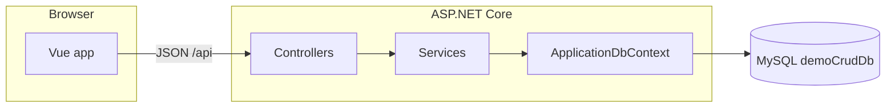
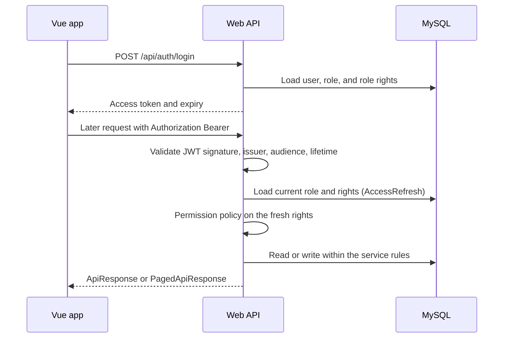
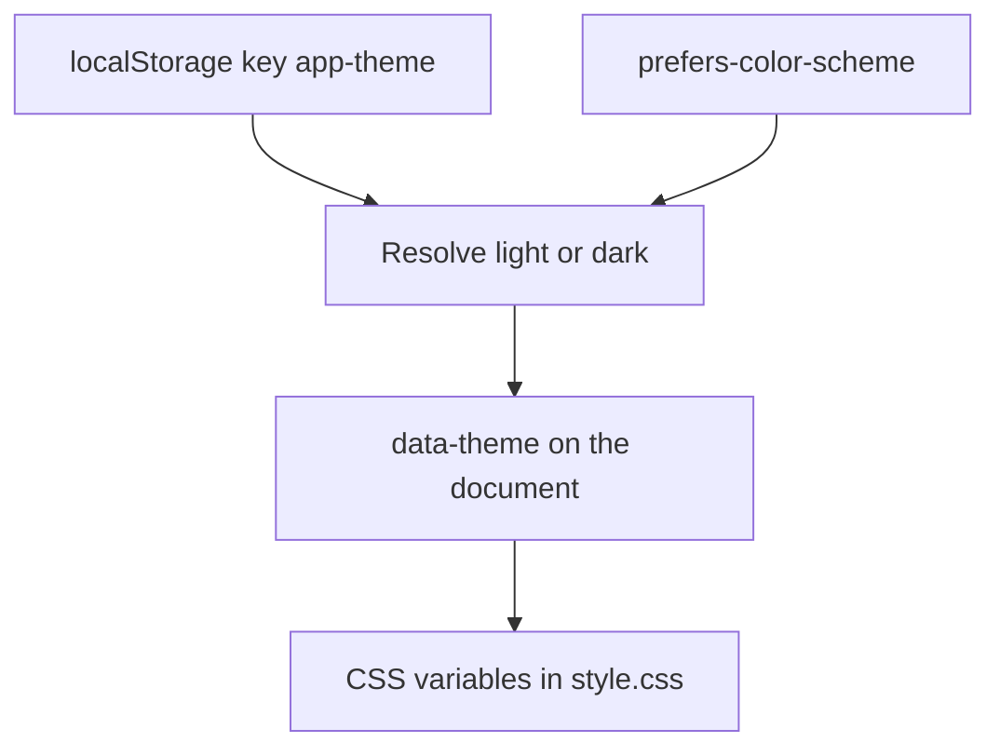

# Project Context

## 1. Project Overview

Demo CRUD is a learning application for a permission-based administration API and a Vue client.

- ASP.NET Core Web API and C#
- Entity Framework Core and MySQL
- JWT authentication and rights-based authorization
- Vue 3 frontend with a light, dark, and system theme

The repository name is `demoCrudBackend`. The running application title is **Demo CRUD**. It is a single-organization learning app. It has no multi-tenant model and no production deployment configuration in the repo.

## 2. Repository Structure

```text
project-root/
├── .cursor/rules/          # Backend and frontend conventions
├── backend/
│   ├── demoCrudBackend/    # ASP.NET Core Web API
│   ├── DemoCrudBackend.Tests/
│   └── demoCrudBackend.slnx
├── frontend/               # Vue 3 app
└── docs/
    ├── LEARNING_PROGRESS.md
    ├── PROJECT_CONTEXT.md
    └── PROJECT_HANDOVER_PROMPT.md
```

There is no separate `doc/` directory.

## 3. System architecture



The frontend renders pages, stores the access token for the browser tab, and hides routes and actions the signed-in user cannot perform. The API remains the authority: every protected request is authenticated, and the caller's current role and rights are read from the database before the permission policy runs.



## 4. Backend Technology

- ASP.NET Core Web API
- Target framework: .NET 10 (`net10.0`)
- Entity Framework Core 9.0.9
- Pomelo.EntityFrameworkCore.MySql 9.0.0
- Database: MySQL (`demoCrudDb`)
- Architecture: Controller → Service → DbContext
- JWT Bearer 10.0.15, HS256
- Password hashing: ASP.NET Core `PasswordHasher<User>` (no Identity user store)
- OpenAPI 10.0.8 and Scalar 2.16.2 in Development

## 5. Data model

| Table | Role |
| --- | --- |
| `Users` | Accounts. `RoleId` references `Roles` with delete **Restrict**. |
| `Roles` | Named roles. `IsSystem` marks the seeded system role. |
| `Rights` | Permission catalog. Names match `Authorization/Permissions.cs`. |
| `RoleRights` | Many-to-many between roles and rights. Rows cascade when the role or right is removed. |

`Users.UserName` and `Users.Email` are unique. Role names are unique case-insensitively and at most 100 characters.

## 6. Backend Modules

### Auth

- `AuthController` / `AuthService` / `TokenService`
- `POST /api/auth/login` is anonymous. Body: `username` and `password`, each required and at most 100 characters.
- Success returns `id`, `userName`, `email`, `roleId`, `roleName`, `accessToken`, `expiresAtUtc`, `permissions`, and `accessVersion`.
- The token carries the user id, username, role name, and one `permission` claim per right on that role.
- Access token lifetime comes from `Jwt:AccessTokenMinutes` (30 in `appsettings.json`). Clock skew is 30 seconds.
- There is no refresh-token endpoint. An expired token requires a new login.
- The token only identifies the caller. `AccessRefresh.OnTokenValidated` replaces the role and `permission` claims with the database values on every request. A deleted user gets 401. A database error gives the generic 500 and never falls back to the token claims.
- Authenticated responses carry `X-Access-Version` (fingerprint of role and rights). `GET /api/auth/me` returns the current `roleId`, `roleName`, `permissions`, and `accessVersion`. The Vue app uses both to refresh menus and route checks.

### Account

- `AccountController` / `AccountService`
- `[Authorize]` only. No extra permission policy. The caller id comes from the token, never from the body.
- `GET /api/account` returns the signed-in profile.
- `PUT /api/account` updates `firstName`, `lastName`, `email`, `phoneNumber`, `gender`, `dateOfBirth`, `address`, and `imageUrl`.
- `dateOfBirth` is a calendar date. "Today" is the UTC date. A later calendar date is rejected. The time of day is not used, and the submitted year-month-day is not shifted into another timezone. The Vue forms use the same rule.
- Username, role, system flag, and user id in a body are ignored. A duplicate email returns 409.
- `imageUrl` is written as sent. Omitting it stores null and clears a previously saved image URL.
- `POST /api/account/change-password` takes `currentPassword` and `newPassword`.
- The new password must be 8–100 characters, the current password must match the stored hash, and the new password must not match the current hash.
- A successful password change does not revoke existing access tokens. They stay valid until they expire.

### Users

- Full CRUD with policies `User_View`, `User_Create`, `User_Edit`, and `User_Delete`.
- Paged list: `GET /api/users?pageNumber=&pageSize=`.
- Create and update require a password of 8–100 characters on create. The password is hashed. `IsSystem` is never taken from the client.
- The caller cannot update or delete their own account through the users API.
- The caller cannot update or delete a system user, and cannot assign the system role.
- Create and update reject a role whose rights are not a subset of the caller's token permissions.
- Delete rejects a target user whose current role includes a permission the caller does not hold.
- Unique `UserName` and `Email`. Write failures map to 400, 403, 404, or 409.

### Roles

- `RolesController` / `RoleService`
- Paged list and get-by-id hide `IsSystem` roles. A missing role and the system role both return 404 on read.
- Create and update take `{ "name" }` only. `IsSystem` is never accepted or returned.
- Name is trimmed, max 100, unique case-insensitively (409 if taken, including `SuperAdmin`).
- Delete returns 409 while any user still has that `RoleId`.
- Update, delete, assign, and remove return 403 for the system role.

### Role rights

- `GET /api/roles/{id}/rights` requires `Role_View` and returns only rights the caller already holds.
- `POST` assigns and `DELETE` removes `{ "rightIds": [1, 2] }`. Both require `RoleRight_Assign`.
- The batch is all-or-nothing. Unknown or duplicate ids are 400. Already assigned, or not assigned, is 409.
- A right the caller does not hold is 403. Rights they cannot see stay on the role.
- The caller cannot remove `Role_View`, `Right_View`, or `RoleRight_Assign` from their own role. Other rights on that role, and rights on a different role, still follow the existing assign and remove rules. The Vue Rights page also warns before changing the signed-in user's role, because the change applies to that session immediately.

### Rights

- Read-only catalog: `GET /api/rights` requires `Right_View`.
- Paged, and filtered to the caller's current rights.
- No create, update, or delete right API. New rights are added by code plus a seed migration.

### Seed

Applied by EF Core migrations, including `20261112110243_SeedRoleManagementRights`:

| Seed | Detail |
| --- | --- |
| Rights | `User_View`, `User_Create`, `User_Edit`, `User_Delete`, `Role_View`, `Role_Create`, `Role_Edit`, `Role_Delete`, `RoleRight_Assign`, `Right_View` |
| SuperAdmin | `IsSystem`. Has every right. |
| Admin | Ordinary role. Has every right. |
| User | `User_View` only |
| System user | Username `superadmin`, system role. The password is the development value in the seed code. It is not repeated in this document. |

Rights changes apply to existing tokens on their next request.

### Common API envelope

- `Common/ApiResponse.cs`, `PagedApiResponse<T>`, `PaginationMetadata`
- Controllers use `ApiControllerBase`
- Validation and the authentication challenge or forbid result use the same envelope shape
- An unhandled exception is logged and returned as HTTP 500 with message `An unexpected error occurred.` The response does not include the exception message or stack trace.

List query defaults are page 1 and size 10. Values below 1 are replaced with those defaults. `pageSize` above 100 is capped at 100.

## 7. Dependency Injection (`Program.cs`)

- `IUserService` → `UserService`
- `IAccountService` → `AccountService`
- `IRoleService` → `RoleService`
- `IRightService` → `RightService`
- `IAuthService` → `AuthService`
- `ITokenService` → `TokenService`
- `IAccessSnapshotService` → `AccessSnapshotService` (one query for the caller's role and rights, used by `AccessRefresh.OnTokenValidated`)
- `IPasswordHasher<User>` → `PasswordHasher<User>`
- `IAuthorizationMiddlewareResultHandler` → `ApiAuthorizationMiddlewareResultHandler`
- JWT Bearer with `OnTokenValidated = AccessRefresh.OnTokenValidated`, and one authorization policy per name in `Permissions.All`
- CORS exposes `X-Access-Version` to the Vite origin
- In-memory fixed-window rate limiter for login (per IP) and password change (per user), and `ApiExceptionHandler` for the generic 500 envelope

`Database:Provider` is read at startup. When it is `Sqlite`, MySQL auto-detection is skipped. The integration tests set that value. Local development leaves it unset and uses MySQL.

## 8. Architectural Decisions

- Keep MySQL and Controller → Service → DbContext.
- Do not introduce a repository layer without discussion.
- Do not hardcode a business role hierarchy in C#.
- Prefer permission policies plus service-layer guards for system accounts, self-updates, and privilege ceiling.
- The JWT identifies the caller; the database is authoritative for role and rights on every authenticated request. Revocations and grants apply on the next request, at the cost of one indexed query per request. No cache, so there is nothing to invalidate across servers.
- One response envelope for the Vue app and Scalar.
- The account API identifies the caller from the token.

## 9. Tests

`backend/DemoCrudBackend.Tests` is an xUnit project referenced by `backend/demoCrudBackend.slnx`. It hosts the API with `WebApplicationFactory` and EF Core SQLite in memory. It does not open MySQL.

Coverage includes login-related user security (self and system-user protection, privilege ceiling), the account API (profile read and update, ignored identity fields, password change rules), date-of-birth rules, rate limiting and exception handling, and live permission refresh (`PermissionRefreshTests`: revoke and restore on the same token, grants, role moves, deleted users, a failing rights lookup, and bad or expired tokens). The last verified run passed 74 tests.

```bash
dotnet test backend/demoCrudBackend.slnx
```

## 10. Frontend

Vue 3, TypeScript, Vite, Vue Router, Pinia, Axios, and Tailwind CSS 4. Setup is in the root `README.md` and `frontend/README.md`.

### Session

- Login stores the access token in `sessionStorage` under `demoCrud.accessToken`.
- Axios attaches `Authorization: Bearer` and clears the session on HTTP 401.
- Expiry and a 401 on a protected page return to `/login` and keep the path. Explicit logout does not.
- A reload restores user id, username, and role name from the token. Its permission claims are used only until `GET /api/auth/me` answers. Email and role id are not claims. The Account page loads them from `GET /api/account`.
- Rights stay in step with the API: the store re-reads `GET /api/auth/me` when `X-Access-Version` changes, after a 403, before permission routes, on tab focus, and every 60 seconds while visible. If the current route loses a needed right, the app moves to Access Denied.
- Axios times out after 30 seconds with a message that asks the user to refresh and check whether the change was saved.

### Theme



- Preference is `light`, `dark`, or `system`. A missing value is `system`.
- The header, the login page, and the 404 page share `ThemeSelector`. It offers System, Light, and Dark. The checked option is the saved preference. System follows the operating system. Light and Dark stay explicit.
- `index.html` applies the same rules before Vue loads.
- Components use semantic tokens (`bg-page`, `bg-surface`, `text-foreground`, `bg-accent-solid`, and the related tokens). Filled controls use the solid accent so dark mode does not paint large pale-blue surfaces.

### Pages

| Area | Behavior |
| --- | --- |
| Login | Username and password. Field validation, show/hide password, duplicate-submit guard, theme toggle. |
| Dashboard | Welcome text from the current session. Shortcut cards for Users, Roles, Rights, and Account, using the same permission rules as the sidebar. No summary or activity API, so there are no counts or a feed. |
| Users | Paged list, create, edit, delete. Own account and system accounts have no edit or delete actions, and a direct edit URL explains that instead of showing the form. Password minimum is 8 characters. Unsaved user and role forms ask before navigation, refresh, or tab close. |
| Roles | Paged list, create, edit, delete. System roles are omitted by the API. |
| Rights | `/rights` with `Role_View` and `Right_View`. Search, multi-select, assign, and remove. Assign and remove also require `RoleRight_Assign`. `/roles/:id/rights` redirects here with `roleId`. |
| Account | Profile summary, personal fields, and a separate password form. The update body does not send user id, username, role, or the system flag. Unsaved profile or password fields ask before leaving. |
| Not found | Unknown paths render a public 404 page outside the signed-in layout. It links to the dashboard. The auth guard still protects `/`. |

The UI does not invent rights. Names come from the API. There is no rights create/update/delete screen.

## 11. HTTP API

| Method | Path | Permission | Success |
| --- | --- | --- | --- |
| POST | `/api/auth/login` | Anonymous | 200 |
| GET | `/api/auth/me` | Authenticated | 200 |
| GET | `/api/account` | Authenticated | 200 |
| PUT | `/api/account` | Authenticated | 200 |
| POST | `/api/account/change-password` | Authenticated | 200 |
| GET | `/api/users` | `User_View` | 200 paged |
| GET | `/api/users/{id}` | `User_View` | 200 |
| POST | `/api/users` | `User_Create` | 201 |
| PUT | `/api/users/{id}` | `User_Edit` | 200 |
| DELETE | `/api/users/{id}` | `User_Delete` | 200 |
| GET | `/api/roles` | `Role_View` | 200 paged |
| GET | `/api/roles/{id}` | `Role_View` | 200 |
| POST | `/api/roles` | `Role_Create` | 201 |
| PUT | `/api/roles/{id}` | `Role_Edit` | 200 |
| DELETE | `/api/roles/{id}` | `Role_Delete` | 200 |
| GET | `/api/roles/{id}/rights` | `Role_View` | 200 |
| POST | `/api/roles/{id}/rights` | `RoleRight_Assign` | 200 |
| DELETE | `/api/roles/{id}/rights` | `RoleRight_Assign` | 200 |
| GET | `/api/rights` | `Right_View` | 200 paged |

Failed validation is 400 with `success: false` and field names in `errors`. A missing or invalid token, or a token for a deleted user, is 401. A caller whose current role lacks the policy permission is 403.

## 12. Security controls that exist

- Password hashing with `PasswordHasher<User>`.
- JWT signature, issuer, audience, and lifetime checks.
- Permission policies on users, roles, role rights, and the rights catalog.
- Account operations bound to the token's user id.
- Service guards for system users, system roles, self-service through the users API, and assigning a role beyond the caller's rights.
- Role-right changes limited to rights the caller currently holds in the database.
- Permissions read from the database on every authenticated request. A failed lookup returns 500 and never falls back to token claims.
- CORS in Development for the configured Vite origin.
- The JWT signing key and the local MySQL password are expected in user secrets or environment variables. The committed `ConnectionStrings:DefaultConnection` value is a placeholder.
- `POST /api/auth/login` is limited to 5 requests per minute for each client IP. `POST /api/account/change-password` is limited to 5 requests per minute for each authenticated user. The counters are in memory for that API process. A second instance, or a restart, has its own counters. This is not a distributed limit.

## 13. Limitations

These are not implemented:

- Refresh tokens, server-side logout, or revocation of outstanding access tokens. Tokens last 30 minutes. Logout only clears the tab's copy, and a password change does not invalidate tokens already issued
- Distributed rate limiting, audit logging, and account lockout
- A rights write API
- A dashboard or activity summary API
- User-list search on the API (the list accepts only `pageNumber` and `pageSize`)
- A production hosting, secret-rotation, or deployment story in this repository
- Browser end-to-end tests (browser QA so far was manual)
- A phone-number format rule (any text up to 50 characters is accepted). Add one only when something depends on the number
- Low-severity UI items from manual QA: focus returns to the page body after Assign or Remove on Rights Management; Create and Edit User pages have no heading element; a direct router move between two user edit URLs keeps the first page's state until reload
- Upgrades for the current NuGet advisories: transitive `Microsoft.OpenApi` 2.0.0 (GHSA-v5pm-xwqc-g5wc), transitive `MySqlConnector` 2.4.0 (GHSA-473q-m89c-ghf8), and test-only `SQLitePCLRaw.lib.e_sqlite3` 2.1.10 (GHSA-2m69-gcr7-jv3q)

Passing the current test suites does not by itself make the application production-ready.

## 14. Development Rules

- Understand the current code before changing it.
- Keep changes small.
- Follow `.cursor/rules` for backend and frontend conventions.
- Do not add a rights create, update, or delete API unless a task explicitly asks for it.
