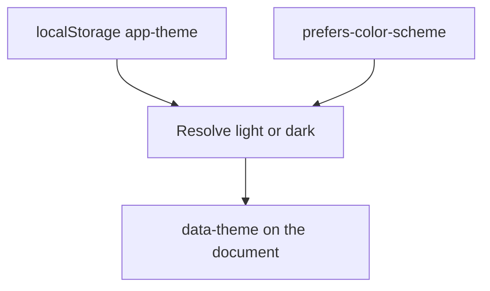

# Demo CRUD frontend

Vue application for the [Demo CRUD](../README.md) API. Sign-in, the application shell, dashboard, users, roles, rights, account, a public 404 page, and the theme are implemented against the existing API.

Backend setup, the database, JWT, and the API list are in the [repository README](../README.md). This file covers the frontend.

## What this module does

The app title on the sign-in page is **Demo CRUD**. The sidebar brand is **DemoCrud**. `npm run dev` serves the sign-in page and, after login, the dashboard.

| Area      | What it does                                                                                                                                                                                               |
| --------- | ---------------------------------------------------------------------------------------------------------------------------------------------------------------------------------------------------------- |
| Login     | `POST /api/auth/login`. Field validation, show/hide password, and a duplicate-submit guard. Invalid credentials stay on the form. The password field is cleared after a successful login.                  |
| Theme     | Preference `light`, `dark`, or `system` in `localStorage` key `app-theme`. The control on the login page, the header, and the 404 page offers System, Light, and Dark.                                     |
| Session   | Access token in `sessionStorage` under `demoCrud.accessToken`. Restored when the tab reloads. Cleared on logout, expiry, and HTTP 401.                                                                     |
| HTTP      | Shared Axios client attaches `Authorization: Bearer`, clears the session on 401, syncs rights on `X-Access-Version` and 403, and times out after 30 s.                                                     |
| Routes    | Auth and permission guards. A missing permission opens Access Denied. An unknown path opens a public 404 page.                                                                                             |
| Dashboard | Welcome text from the session, plus shortcut cards for the pages the current rights allow. No counts and no activity feed.                                                                                 |
| Users     | Paged list, create, edit, delete. The role field is a dropdown of roles the API returns. Edit and delete are hidden for the signed-in account and for system accounts, and a direct edit URL explains why. |
| Roles     | Paged list, create, edit, delete.                                                                                                                                                                          |
| Rights    | `/rights` searches and assigns rights for a selected role. Assign and remove are hidden without `RoleRight_Assign`.                                                                                        |
| Account   | Profile from `GET /api/account`, an edit form, and a separate password form. Dirty account, user, and role forms warn before navigation or a refresh.                                                      |

Permission checks in the UI are a guide. The API still enforces every policy.

## Technology stack

Declared in `package.json` and wired in source:

| Piece        | Version range     | Used for                                           |
| ------------ | ----------------- | -------------------------------------------------- |
| Vue          | `^3.5.44`         | UI. Components use `<script setup lang="ts">`.     |
| TypeScript   | `~6.0.3` (strict) | `tsconfig.app.json`                                |
| Vite         | `^8.3.6`          | Dev server and production build (`vite.config.ts`) |
| Vue Router   | `^5.5.0`          | `src/router/index.ts`                              |
| Pinia        | `^4.1.0`          | Auth store in `src/stores/authStore.ts`            |
| Axios        | `^1.21.1`         | Shared client in `src/services/http.ts`            |
| Tailwind CSS | `^4.3.5`          | `@tailwindcss/vite`. Tokens in `src/style.css`.    |
| Vitest       | `^5.1.0`          | `npm test`, with Vue Test Utils and happy-dom      |

npm is the package manager (`package-lock.json`).

## Prerequisites

- Node.js `^20.19.0` or `>=22.12.0` (the `engines` range of Vite 8).
- npm.
- The API from the repository root. See [Getting started](../README.md#getting-started).

## Installation

From the `frontend` directory:

```bash
npm install
```

From the repository root:

```bash
npm install --prefix frontend
```

## Environment configuration

Vite reads `frontend/.env`. That file is gitignored. The tracked template is `.env.example`:

```text
VITE_API_BASE_URL=https://localhost:7193/api
```

Create the local file.

PowerShell:

```powershell
Copy-Item .env.example .env
```

Bash:

```bash
cp .env.example .env
```

`VITE_API_BASE_URL` is required and must include the `/api` prefix. The value above matches the backend `https` launch profile (`https://localhost:7193`). If you run `--launch-profile http` instead, set it to `http://localhost:5118/api`.

`VITE_DEV_LOGIN_USERNAME` and `VITE_DEV_LOGIN_PASSWORD` are optional. They prefill the sign-in form only when Vite's mode is `development`. They are not used by `npm test` or `npm run build`. Do not put passwords, JWT signing keys, or access tokens in a file you commit.

Restart `npm run dev` after you change `.env`.

The backend allows browser calls from `http://localhost:5173` when it runs in Development (`Cors:AllowedOrigin` in `backend/demoCrudBackend/appsettings.Development.json`). If the dev server binds a different port, update that setting and restart the API.

## Development server

From `frontend`:

```bash
npm run dev
```

Open `http://localhost:5173`. Signed-out visitors are sent to `/login`.

The seeded username is `superadmin`. The password is the development seed on that user in `backend/demoCrudBackend/Data/ApplicationDbContext.cs`. It is not written in this file.

## Production build

```bash
npm run build
```

This runs `vue-tsc -b` and then `vite build`. Output goes to `frontend/dist/`, which is gitignored. The built client uses the `VITE_API_BASE_URL` that was present at build time.

Preview the built files locally:

```bash
npm run preview
```

Vite's default preview port is 4173 when the config does not override it: `http://localhost:4173`.

## Folder structure

```text
frontend/
├── index.html              # Applies the theme before Vue loads
├── package.json
├── package-lock.json
├── vite.config.ts
├── .env.example
└── src/
    ├── components/         # Fields, dialog, alerts, sidebar, header, theme control
    ├── features/           # Form helpers for users, roles, rights, and account
    ├── layouts/
    │   └── AppLayout.vue
    ├── navigation/         # Sidebar and dashboard links
    ├── router/             # Routes and the auth guard
    ├── services/           # Axios client, auth, account, users, roles, rights
    ├── stores/
    │   └── authStore.ts
    ├── theme/              # Preference, resolved theme, and useTheme
    ├── types/
    ├── utils/
    ├── views/              # Login, dashboard, users, roles, rights, account, 404
    ├── App.vue
    ├── main.ts
    └── style.css           # Semantic color tokens
```

Import application code with the `@/` alias (`@` is `src`).

## Routing

`src/router/index.ts` uses `createWebHistory`. Protected pages sit under `AppLayout`.

| Path                | Name            | Access                                                |
| ------------------- | --------------- | ----------------------------------------------------- |
| `/login`            | `login`         | Public. Signed-in users leave this page.              |
| `/`                 | `home`          | Signed in                                             |
| `/access-denied`    | `access-denied` | No extra permission. The guard does not loop here.    |
| `/users`            | `users`         | `User_View`                                           |
| `/users/create`     | `users-create`  | `User_Create`                                         |
| `/users/:id/edit`   | `users-edit`    | `User_Edit`                                           |
| `/roles`            | `roles`         | `Role_View`                                           |
| `/roles/create`     | `roles-create`  | `Role_Create`                                         |
| `/roles/:id/edit`   | `roles-edit`    | `Role_Edit`                                           |
| `/rights`           | `rights`        | `Role_View` and `Right_View`                          |
| `/roles/:id/rights` | `roles-rights`  | Redirects to `/rights?roleId=`. Same two permissions. |
| `/account`          | `account`       | Signed in                                             |
| Any other path      | `not-found`     | Public. The page is not inside the signed-in layout.  |

A route with several permissions requires every one of them. Before opening a route that needs a right, the guard re-reads the signed-in user's rights from `GET /api/auth/me`. If that call fails for a reason other than 401, it uses the last known rights. The API still enforces every request. An unknown path matches `not-found` and stays there whether or not a token is present. The dashboard link goes to `/`, and the existing guard still sends a signed-out visitor from `/` to login.

Sidebar links use the same permission lists: Dashboard and Account have none, Users needs `User_View`, Roles needs `Role_View`, and Rights Management needs `Role_View` and `Right_View`. Dashboard cards follow that list and omit the home item.

## Theme



- A missing or invalid stored value is `system`.
- `index.html` and `src/theme/theme.ts` share the storage key, the color-scheme query, and the `data-theme` / `data-theme-preference` attributes.
- `ThemeSelector` offers System, Light, and Dark. The checked option is the saved preference. System follows `prefers-color-scheme`. Light and Dark stay fixed when the operating system changes.
- Components use tokens such as `bg-page`, `bg-surface`, `text-foreground`, `text-accent`, and `bg-accent-solid`. Filled buttons use the solid accent.

## Accessibility and layout

- Every input, select, button, and link shows a focus outline when reached by keyboard. Inputs that use `outline-none` must pair it with `focus-visible:outline-solid`; `src/components/focusIndicator.spec.ts` fails if a component uses the bare `focus-visible:outline` with `outline-none` (Tailwind v4 then draws no outline).
- Below 1024 px the sidebar becomes a drawer. The menu button reports the drawer state with `aria-expanded` and `aria-controls="app-navigation"`. Opening moves focus into the drawer, Tab stays inside it, and Escape closes it and returns focus to the menu button. Closed drawer links are not focusable.
- Confirm dialogs use `role="dialog"` and `aria-modal`, keep Tab inside, close on Escape, and return focus to the button that opened them.
- Tables scroll inside their own container. In the Users table, name, username, and email are capped at 16rem and wrap only when longer.
- The tab title changes only after a navigation completes, so staying on a form after the unsaved-changes prompt keeps its title.

## State management

`useAuthStore` holds the access token, the signed-in user, permission names, and the expiry time. `src/services/tokenStorage.ts` is the only module that reads or writes the access token in `sessionStorage`. The Axios interceptor reads the token from that module. Theme preference uses `localStorage` through `src/theme/theme.ts`, not through components.

There is no refresh token. The store schedules a timer from the token `exp` claim. When that timer fires, or a response is HTTP 401, the session is cleared and `App.vue` sends the browser to `/login` with a `redirect` query. `logout()` clears the session without restoring the previous path.

A tab reload restores the user id, username, and role name from the token, and uses the token's permission claims only until the first `GET /api/auth/me` answer replaces them. Email is not a claim, so it stays empty until the next login.

### Live rights refresh

The API reloads role and rights from the database on every request and returns their fingerprint in the `X-Access-Version` header. `src/services/http.ts` passes that header, and any 403, to `src/services/accessSync.ts`. The store then calls `refreshAccess()` (one shared request to `GET /api/auth/me`) when the version differs from `accessVersion`. It also refreshes before permission routes, on tab focus or visibility, and every 60 seconds while visible. `setupAccessWatcher` in `src/router/guards.ts` sends the user to Access Denied when a refresh removes a right the current route needs. A failed refresh keeps the last known rights; a 401 ends the session. The Account page does not use that snapshot for the profile. It calls `GET /api/account`.

## API integration

`src/services/http.ts` creates one Axios instance:

- `baseURL` is `import.meta.env.VITE_API_BASE_URL`
- Default headers are `Accept: application/json` and `Content-Type: application/json`
- `timeout` is `REQUEST_TIMEOUT_MS` (30 seconds). A request with no answer by then fails with a message that asks the user to refresh and check whether the change was saved before retrying, because the server may have applied it
- The request interceptor sets `Authorization` when a token is stored and the request did not set one
- The response interceptor calls the registered session handler on HTTP 401. On other responses it passes the `X-Access-Version` header to the auth store, and on HTTP 403 it asks the store to re-read rights (see Live rights refresh)

Feature modules:

| Module              | Calls                                                                |
| ------------------- | -------------------------------------------------------------------- |
| `authService.ts`    | `POST /auth/login`, `GET /auth/me`                                   |
| `accountService.ts` | `GET` and `PUT /account`, `POST /account/change-password`            |
| `userService.ts`    | `/users` list, get, create, update, delete                           |
| `roleService.ts`    | `/roles` list, get, create, update, delete, and `/roles/{id}/rights` |
| `rightService.ts`   | `GET /rights`                                                        |

Responses use `src/types/api.ts`:

- `ApiResponse<T>` for login, get-by-id, and writes
- `PagedApiResponse<T>` for lists (`data` is the item array)

List queries are `pageNumber` and `pageSize` (default page size 10 on the lists, choosable as 5–100 under the table, up to 100 when a form needs every visible role or right). The users list has no search parameter. `src/services/apiError.ts` maps the envelope `message` and `errors` onto form and page errors. HTTP 403, 404, and 409 stay on the page that made the call. They do not sign the user out.

## Forms

Each feature validates in its own helper before submit, then shows API field errors if the request fails. There is no shared form library.

- User create requires a password of 8–100 characters. Optional phone, address, and image URL are length-checked. Gender is a select (Male, Female, Other, or empty) on the user and account forms; `src/features/genderOptions.ts` holds the list. Phone has no format rule, only the 50-character limit.
- Account profile requires first name, last name, and email. Phone, gender, date of birth, and address are optional. The update body also sends the existing `imageUrl` so a profile save does not clear a stored image. The page has no image upload.
- Date of birth is a `YYYY-MM-DD` calendar date. The form and the API both use the current UTC date as "today" and reject a later date. The date input `max` uses that same UTC date.
- While a save runs, the submit button and fields are disabled, so repeated clicks send one request. A failed save keeps the typed values and shows the API message, "Could not reach the server", or the timeout message.
- Account, user, and role forms compare the current values with the last loaded values. Leaving the page, refreshing, or closing the tab asks for confirmation while the form is dirty. A successful save clears that warning. Delete confirmations are separate and unchanged.
- The password form asks for current, new, and confirm. Confirm stays in the browser. The request sends `currentPassword` and `newPassword` only. New and current are compared as entered, and the new password must be 8–100 characters.
- The Rights page warns before changing the signed-in user's own role. The API rejects removal of `RoleRight_Assign`, `Role_View`, or `Right_View` from that role with 403. Another user who already holds `RoleRight_Assign` can still change that role under the existing role-rights rules. Other rights on the caller's own role can still be removed. Rights changes apply on the next request, including for the signed-in user.

## Authentication integration

1. `POST /api/auth/login` with `username` and `password`.
2. Read `data.accessToken` and `data.expiresAtUtc` from the envelope.
3. Later requests send `Authorization: Bearer <access_token>`.

Access tokens expire (30 minutes in the committed API settings). The API checks the role's current rights in the database on every request, not the permission names inside the token. Hiding a button does not replace that check.

## Development guidelines

- Use `<script setup lang="ts">` and the Composition API.
- Prefer `ref` and `computed`. Avoid `any`.
- Put HTTP in `src/services/`. One module per area.
- Do not read the access token from components. Theme reads go through `src/theme/`.
- Use Tailwind utilities and the semantic tokens in `src/style.css`.
- Show loading, empty, and error states. Surface the envelope `message` and field `errors`.
- Keep a change easy to follow. This is a learning project; skip extra libraries and wrappers.
- Longer notes live in the repo-root `.cursor/rules/` files whose names start with `frontend-`.

### Scripts

| Command                | Purpose                          |
| ---------------------- | -------------------------------- |
| `npm run dev`          | Vite dev server                  |
| `npm run build`        | Typecheck and production build   |
| `npm run preview`      | Serve the production build       |
| `npm test`             | Vitest once (`src/**/*.spec.ts`) |
| `npm run test:watch`   | Vitest watch mode                |
| `npm run lint`         | ESLint                           |
| `npm run lint:fix`     | ESLint with auto-fix             |
| `npm run format`       | Prettier write                   |
| `npm run format:check` | Prettier check                   |

Last verified run: 253 tests in 34 files pass, lint and Prettier are clean, `vue-tsc -b` reports no errors, and `vite build` succeeds. Browser behavior was checked manually; there are no end-to-end tests.

Before you open a pull request that touches the UI or types:

```bash
npm run lint
npm run format:check
npm test
npm run build
```

Check the changed screen in the browser at `http://localhost:5173`. The root README describes the [branch and pull request](../README.md#contributing) steps.
